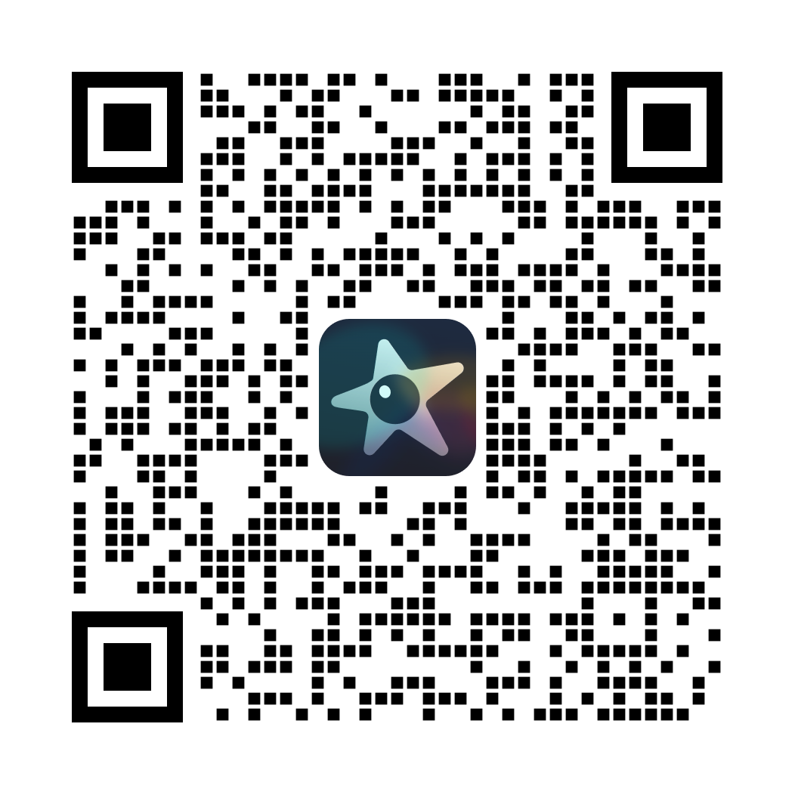

Sharing plans with QR codes and links
=====================================

The Seestar app (v3.4.1 and later) can share an observation plan as a link
or a QR code.  The plan is uploaded to ZWO's cloud service, and whoever
opens the link or scans the code in the Seestar app can import it.
seestarpy talks to the same service, so a plan built in Python can be
handed to any Seestar user, and a plan someone shares with you can be run
from Python.  No ZWO account is needed.

.. note:: The service was reverse engineered from the decompiled Seestar
   app v3.4.1 and tested on 2026-11-04: plans shared from seestarpy import
   into the phone app both from the link and by scanning the QR code.

.. warning:: A shared plan can be read by anyone who has its link, and
   there is no way to delete it.  Don't put anything private in the plan
   or target names.

Sharing a plan as a link
------------------------

Build a plan as usual (see :doc:`observation_plans`) and pass it to
:func:`~seestarpy.plan.share_plan`:

.. code-block:: python

    from seestarpy import plan

    p = plan.create_named_plan(
        "Evening Session",
        [("M42", "21:00"), ("M31", "22:30")],
        end_time="23:30",
    )

    share = plan.share_plan(p)
    share["share_id"]      # 'sh0xivw4'
    share["share_link"]    # 'https://app.zwoastro.com/Seestar/plan?id=sh0xivw4'

Send the link to a phone with the Seestar app installed; opening it offers
to import the plan.

Per-target settings added with :func:`~seestarpy.plan.configure_plan`
(exposure, photometry mode, camera, tracking) are shared with the plan.

Sharing a plan as a QR code
---------------------------

:func:`~seestarpy.plan.share_plan_qrcode` returns the same QR code the app
shows under *Share*: a 1052 x 1052 px PNG with the Seestar logo in the
centre.

.. code-block:: python

    png = plan.share_plan_qrcode(p, path="evening_session_qr.png")

The code encodes a link of the form
``https://app.zwoastro.com/Seestar/plan?id=<share_id>``, so it can be
scanned with the Seestar app or with the phone camera.

Every call creates a new share, and the QR service returns only the image,
not the share ID.  To get the ID *and* a QR code for the same share, call
:func:`~seestarpy.plan.share_plan` and turn ``share_link`` into a QR code
with any QR library, for example::

    import qrcode                      # pip install qrcode[pil]
    share = plan.share_plan(p)
    qrcode.make(share["share_link"]).save("evening_session_qr.png")

Importing a shared plan
-----------------------

:func:`~seestarpy.plan.get_shared_plan` takes a share link, the URL inside
a QR code, the app's ``seestar://zwo.biz/Seestar/plan?id=...`` link, or a
bare share ID, and returns a plan dictionary ready for
:func:`~seestarpy.plan.set_view_plan`:

.. code-block:: python

    p2 = plan.get_shared_plan("https://app.zwoastro.com/Seestar/plan?id=sh0xivw4")
    for t in p2["list"]:
        print(t["target_name"], t["start_min"], t["duration_min"])

    plan.set_view_plan(p2)

:func:`~seestarpy.plan.parse_share_id` pulls the ID out of a link on its
own.

.. warning:: ``start_min`` is shared unchanged, so an imported plan keeps
   the sharer's local start times.  Check them against your own clock
   before :func:`~seestarpy.plan.set_view_plan`: a start time that is
   already past makes the plan begin as soon as it arrives.

Errors
------

=====================  =====================================================
Exception              Cause
=====================  =====================================================
``ValueError``         A target the app would drop on import: it needs a
                       positive ``target_id`` and ``duration_min``, a name,
                       ``start_min >= 0``, RA in [0, 24] h and Dec in
                       [-90, 90] deg.  Also raised for a link that is not a
                       plan-share link.
``ConnectionError``    The ZWO service could not be reached.
``RuntimeError``       The service refused the request, e.g. an unknown
                       share ID (``ZWO share service error 100002:
                       Parameter error``).
=====================  =====================================================

How it works
------------

The service lives at ``https://api.seestar.com`` and replies with a
``{"code", "msg", "data"}`` envelope, where ``code`` 200 means success.

======  ==========================  ======================================
Method  Path                        ``data`` in the reply
======  ==========================  ======================================
POST    ``/v1/share/plan``          ``{"shareId", "shareLink"}``
POST    ``/v1/share/plan/qrcode``   ``{"qrcode"}`` (base64 PNG)
GET     ``/v1/share/plan/{id}``     ``{"payload", "metadata"}``
======  ==========================  ======================================

Both POSTs take the same body.  The plan is encoded twice: ``payload`` is
a JSON string holding the app's plan record, whose own ``payload`` is the
target list as another JSON string::

    {
      "payload": "{\"id\": \"\", \"name\": \"Evening Session\",
                   \"payload\": \"[{\\\"target_id\\\": 123456789, ...}]\",
                   \"createTime\": 1793822259940, \"operationTime\": ...,
                   \"operation\": \"update\",
                   \"recommendDurationMinute\": 150,
                   \"extra\": \"{\\\"wideIncrementId\\\": 0}\"}",
      "metadata": {"planName": "Evening Session", "targetCount": 2,
                   "shootingDurationMinutes": 150}
    }

Each target carries the :func:`~seestarpy.plan.set_view_plan` keys plus
``mosaic``, ``camera``, ``second_camera``, ``mount`` (``null`` when
unset), ``camera_mode`` (``"tele"`` by default) and ``ai_generated``.
